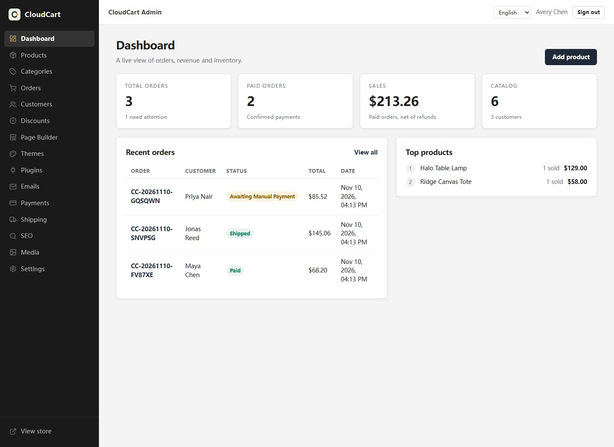
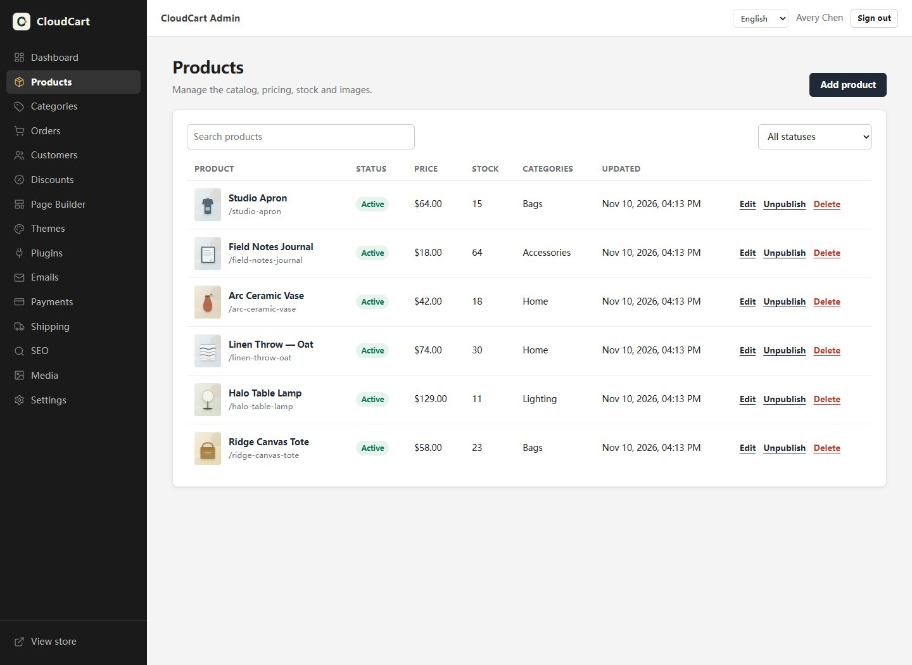
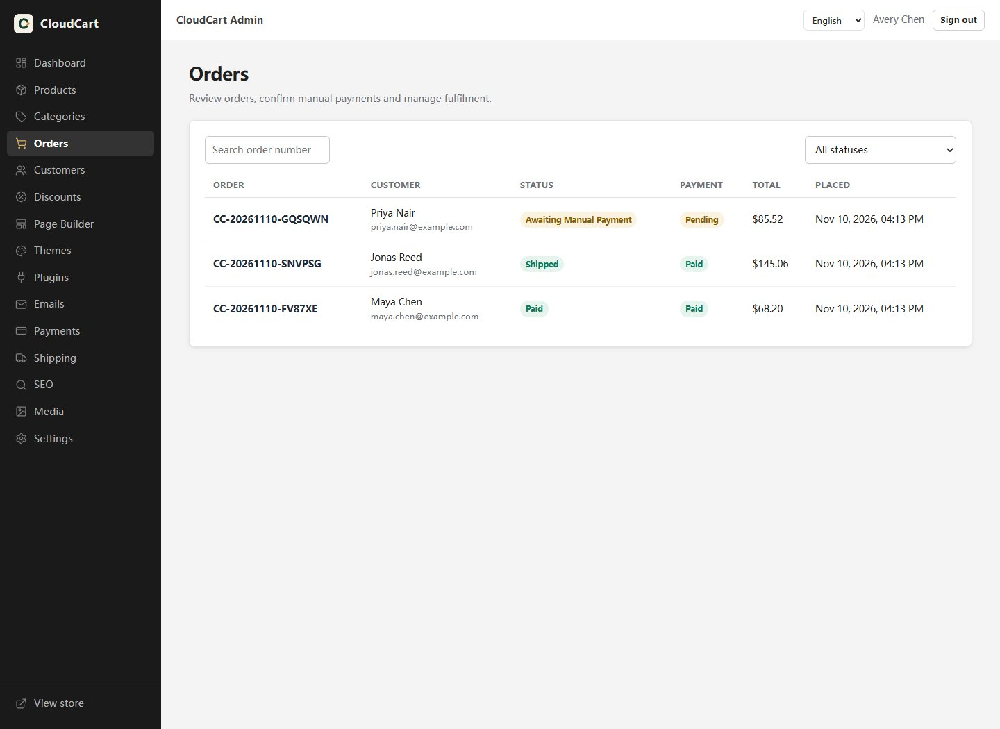
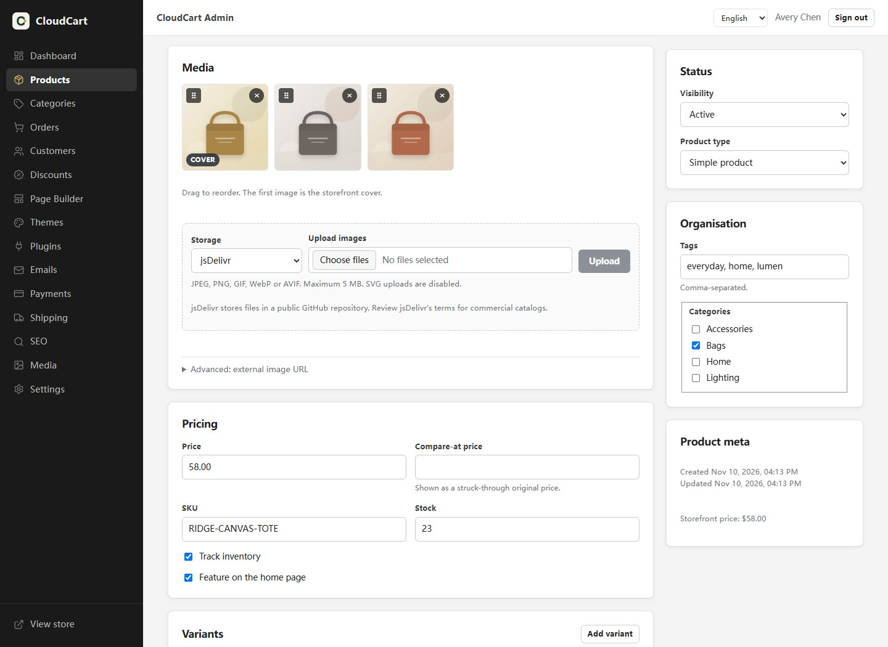
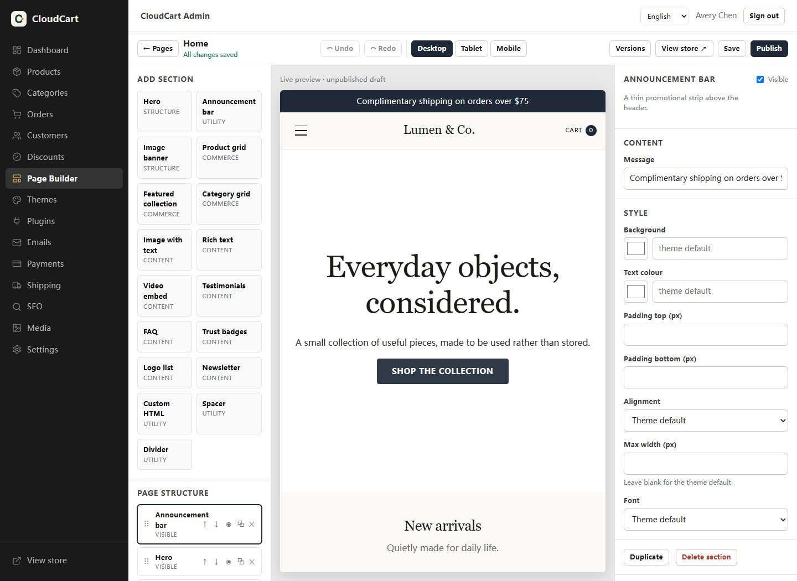
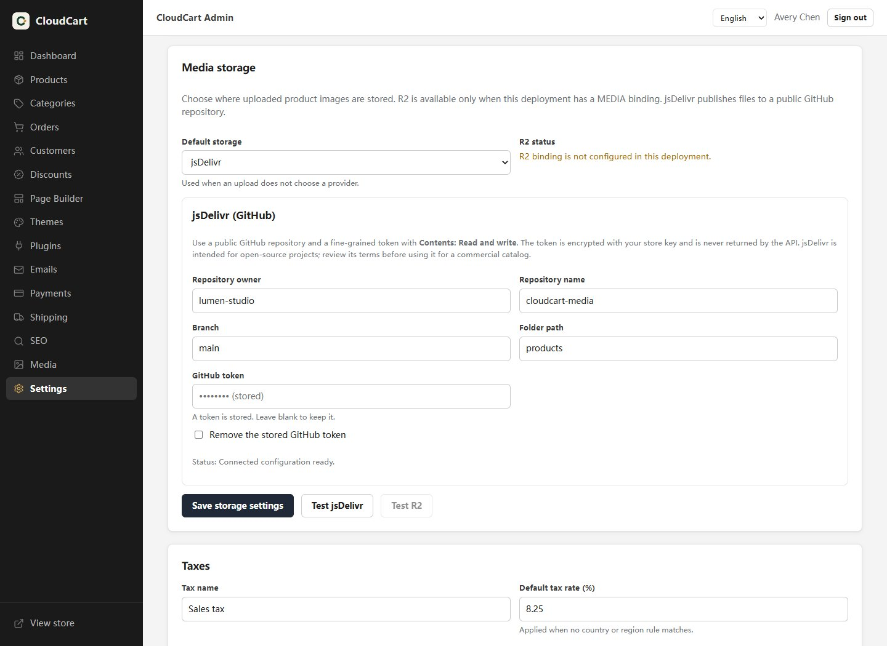
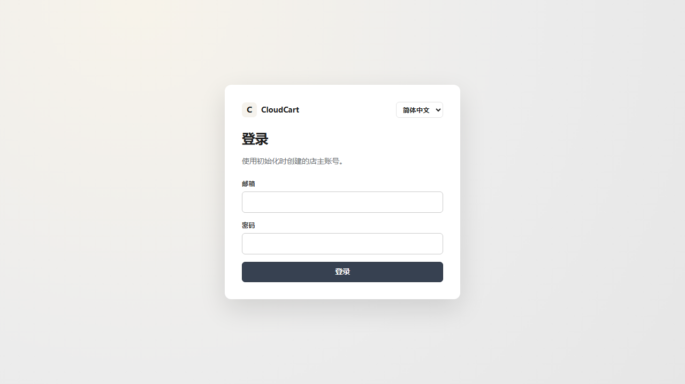

<div align="center">

# CloudCart

**A free, open-source, plugin-based ecommerce platform built natively for Cloudflare Workers.**

One Worker · One D1 database · Local uploads to R2 or jsDelivr · Optional external URLs

[](https://deploy.workers.cloudflare.com/?url=https://github.com/shuo-huge/cloudcart)

[](https://workers.cloudflare.com/)
[](https://developers.cloudflare.com/d1/)
[](LICENSE)
[](docs/TEST_REPORT.md)

[English](README.md) · [简体中文](README.zh-CN.md) · [Architecture](docs/ARCHITECTURE.md) · [Deployment](docs/DEPLOYMENT.md)

</div>

---

## Why CloudCart?

Opening a small online store should not cost more than the products you sell.

CloudCart exists because most ecommerce stacks force you to choose between paying a monthly platform fee, maintaining a server, or giving up control of your data. It removes that trade-off by using Cloudflare's free tier as the entire runtime: edge compute, SQLite, object storage, and static assets.

### The problems it solves

| Pain point | How CloudCart fixes it |
|---|---|
| **Shopify-style subscriptions + paid apps** | No platform subscription. Runs inside Cloudflare Workers Free. You pay for your domain and payment-provider fees, not hosting. |
| **VPS, MySQL, Redis, SSL, backups** | No server to patch, no database to provision. D1 is managed by Cloudflare; images can be uploaded to R2 or published through jsDelivr, with external HTTPS URLs still available. |
| **SaaS lock-in and shared tenants** | Every store is its own Worker + D1 in **your** Cloudflare account; R2 can be added later. You own the data, the code, and the domain. |
| **Heavy SSR frameworks exceed free CPU limits** | Hono + Preact + small string-based SSR. Every public page is still server-rendered and SEO-readable. |
| **Expensive themes and closed page builders** | 8 structurally different bundled themes, a live three-column page editor, and a documented Theme SDK. MIT licensed. |
| **Payment plugins that require a paid backend** | Manual payment, Stripe Checkout, and PayPal Orders v2 are bundled. Secrets are encrypted with AES-GCM. |
| **Admin tools only in English** | The bundled Admin Language Pack adds English / 简体中文 with a runtime switcher. |
| **Fake "one-click" demos** | Every claim here is implemented. Tests run in workerd against D1; R2-backed uploads are optional. Unfinished work is listed explicitly. |

### How it compares

| | **CloudCart** | Shopify | WooCommerce |
|---|---|---|---|
| Monthly platform fee | **$0** on Cloudflare Free | Subscription + paid apps | $0 software, paid hosting |
| Hosting | Cloudflare edge | Included | VPS ($5–20+/mo) |
| Database | D1 (SQLite), included | Vendor-managed | MySQL you maintain |
| Data ownership | **Your Cloudflare account** | Vendor | Yours |
| Multiple stores | One Worker + D1 per store; optional R2 | Plan limits / tenants | One site per install |
| Themes | 8 bundled + SDK | Paid themes | Free/paid extensions |
| Visual page editor | Built in | Built in | Third-party |
| Open source | **MIT** | No | GPL |

---

## Screenshots

A running CloudCart admin with the bundled English UI and demo catalog data. The Chinese README shows the same pages with the Simplified Chinese language pack enabled.

| Dashboard | Products |
| :---: | :---: |
|  |  |
| **Orders and fulfilment** | **Product editor with local media uploads** |
|  |  |
| **Visual page builder** | **Media storage: R2 or jsDelivr** |
|  |  |

---

## One-click deploy

[](https://deploy.workers.cloudflare.com/?url=https://github.com/shuo-huge/cloudcart)

Cloudflare deploys CloudCart into **your** account and provisions D1. R2 is optional. The button uses the repository's root `build` and `deploy` scripts: it builds the storefront/admin, then runs `scripts/deploy.mjs`. You do not need to create or paste any secrets: the script automatically generates `APP_MASTER_KEY` and `SETUP_TOKEN`, stores them as Worker secrets, and prints a private one-time setup URL in the deployment log.

Open the **Setup link** from the latest successful deployment log. The setup page asks only for the administrator name, email and password. Store name and currency use sensible defaults and can be changed later in Admin → Settings. The setup token is carried in the private URL and is not shown as a form field.

The one-time link stops working after the first administrator is created. If you deploy again before installation, use the refreshed link from the latest successful deployment log. No default admin password exists.

### Where is my site link?

The Deploy Button runs the build inside Cloudflare, so it cannot open a browser on your computer. You can find the URL in either place:

1. **Build log**: **Workers & Pages → your project → Deployments → latest → Build logs**. The final lines contain `Website / 网站: https://…` and the one-time setup link.
2. **Dashboard**: **Workers & Pages → your project → Visit**. The `https://<worker>.<subdomain>.workers.dev` URL is also listed under **Settings → Domains & Routes**.

If the setup link is lost before the first administrator is created, retry the deployment; the script prints a fresh one-time link. If the store is already installed, open `/admin` instead.

## CLI deploy (recommended for a complete setup)

```bash
git clone https://github.com/shuo-huge/cloudcart.git
cd cloudcart
pnpm install
pnpm run deploy:cloudflare
```

The CLI checks Node, Wrangler and Cloudflare login, then:

1. finds or creates a D1 database (reusing a database provisioned by the Deploy Button when present),
2. writes the real IDs into `wrangler.jsonc`,
3. builds the storefront and admin,
4. applies remote migrations through the `DB` binding,
5. deploys the Worker,
6. preserves `APP_MASTER_KEY` and creates or refreshes the one-time setup token while the store is uninstalled,
7. prints the store URL, admin URL and one-time setup link.

Re-running is safe: existing resources and secrets are reused, and no data is overwritten. On a local interactive terminal the script opens the store/setup page in your browser automatically; use `--no-open` (or `CLOUDCART_NO_OPEN=1`) to disable that.

```bash
pnpm run deploy:cloudflare -- --name my-store   # named Worker / resources
pnpm run deploy:cloudflare -- --check           # non-mutating environment check
pnpm run deploy:cloudflare -- --no-open         # do not open a browser
```

---

## Local development

Requirements: Node.js 20+ for the store (CI uses 24; `.nvmrc` pins 22) and pnpm 10+ (`packageManager` pins 12.16.1). The documentation site uses Astro 6 and requires Node.js 22.12+.

```bash
pnpm install
pnpm db:migrate:local
pnpm dev
```

`pnpm dev` creates local-only random secrets in `.dev.vars` automatically and prints a one-time setup URL. Existing local secrets are preserved between runs.

Browser end-to-end tests use Playwright against an isolated local D1 database:

```bash
pnpm exec playwright install chromium
pnpm test:e2e
```

| URL | Purpose |
|---|---|
| `/` | Server-rendered storefront |
| `/admin` | Admin SPA |
| `/setup` | One-time installation |
| `/api/*` | Public and admin APIs |
| `/webhooks/stripe`, `/webhooks/paypal` | Payment webhooks |

---

## Documentation site

The public user manual lives in `apps/docs` and uses Astro Starlight. It deploys independently from the store Worker.

```bash
pnpm docs:dev       # local preview at http://localhost:4321
pnpm docs:build     # static output in apps/docs/dist
pnpm docs:deploy    # build and deploy the cloudcart-docs Worker
```

`docs:deploy` uses `wrangler.docs.jsonc` and creates a separate static-assets Worker named `cloudcart-docs`. You can also deploy the same `apps/docs/dist` output through Cloudflare Pages.

Set `DOCS_SITE_URL` before `docs:deploy` (for example `DOCS_SITE_URL=https://docs.example.com`) so canonical URLs and the sitemap use the public domain.

Edit pages under `apps/docs/src/content/docs/**/*.md`; edit the sidebar in `apps/docs/astro.config.mjs`.

Brand icons live in `brand/`. The committed favicon/App icon files are generated from the SVG masters there; run `pnpm icons` after changing the artwork.

---

## Admin CLI (agent-friendly)

`apps/cli` exposes the admin API as a zero-dependency Node CLI so Claude Code, Cursor, Codex, Gemini CLI and scripts can publish products, pages, blog posts, orders and marketing settings without a browser session.

```bash
# First login (creates a scoped API key and stores it in your user profile)
pnpm cloudcart auth login --url https://your-store.example.com --email owner@example.com

# Content operations
pnpm cloudcart products list --json
pnpm cloudcart products create --name "Canvas Tote" --price 25.00 --status active --image https://example.com/tote.jpg --json
pnpm cloudcart blog create --title "Launch notes" --slug launch-notes --text-file post.html --publish --json

# Orders and marketing
pnpm cloudcart orders list --json
pnpm cloudcart coupons create --code SAVE10 --type percent --value 10 --json

# Discovery for agents
pnpm cloudcart capabilities --json
pnpm cloudcart schema product
```

For non-interactive agents, set `CLOUDCART_URL` and `CLOUDCART_API_KEY` in the environment. Add `--json` for stable machine-readable output, `--dry-run` before writes, and `--yes` for destructive operations. API keys are scoped to specific resources, hashed in D1, and revocable with `cloudcart auth logout`.

Product images can be uploaded from Admin or the CLI. Configure the default provider in **Settings → Media storage**:

- **R2** — available when the deployment has a `MEDIA` binding
- **jsDelivr** — publish to a public GitHub repo using a fine-grained PAT (Contents: Read and write); the token is encrypted at rest

```bash
pnpm cloudcart media upload ./photo.jpg --storage jsdelivr --json
pnpm cloudcart products images attach PRODUCT_ID --image-url https://example.com/photo.jpg --storage jsdelivr --json
```

External HTTPS URLs remain available through the advanced panel in Admin or `--external` in the CLI. The standalone `publish:jsdelivr` script is still available for manual bulk publishing. jsDelivr is intended for open-source projects; review its terms before using it for a commercial catalog. R2 is the safer production choice.

Blog posts reuse content pages: each post is published at `/pages/<slug>` with a rich-text section. CloudCart does not ship a posts table, `/blog` index or RSS feed. See [`docs/CLI.md`](docs/CLI.md) for the full command reference.

## What you get

### Storefront
Server-rendered HTML for home, collections, search, product pages, cart, checkout and content pages. Meta tags, canonical URLs, Open Graph, Twitter cards, Product/Breadcrumb/Website JSON-LD, `sitemap.xml`, `robots.txt`, and 301 redirects are built in. Product names and descriptions are crawlable without JavaScript.

### Admin
Dashboard, products and variants, categories, local image uploads to R2 or jsDelivr (plus advanced external URLs), drag-reordered product image galleries, orders, customers, discounts, shipping zones and rates, tax rates, themes, visual page builder with version restore, plugins, email notifications with an outbox log, payment configuration, media library, store settings, SEO redirects, audit log, and local resource estimates.

### Commerce core
Server-side revalidation of prices, stock, coupons, shipping and tax on every checkout. Integer minor-unit money, order snapshots, atomic stock reservation with compensation, an explicit order state machine, manual payment confirmation with an audit trail, and manual shipment tracking. Tax supports country/region rate rules, a default rate, and tax-inclusive or tax-exclusive pricing; tax is included in the order total sent to payment providers.

### 8 bundled themes
Default, Fashion, Beauty, Electronics, Jewelry, Home, Sports, and Single Product. Each has a different layout, typography and card structure, not just a colour swap. All support the same Theme SDK and design tokens.

Theme gallery previews come from a single 4×2 WebP atlas (`apps/storefront/public/themes/theme-previews-atlas.webp`) cropped with CSS, plus a full-size preview modal in Admin → Themes. They are illustrative artwork, not screenshots of a running store.

### Visual page editor
Three-column editor with SortableJS drag ordering, add/remove/duplicate/hide sections, per-section content and style fields, live preview at desktop/tablet/mobile widths, autosaved drafts, undo/redo, publish, immutable version snapshots, and restore-into-draft from any published version. Page JSON is schema-validated and custom HTML is sanitised.



### Payments
- **Manual**: bank transfer, cash on delivery, or custom instructions; admin confirmation with audit.
- **Stripe Checkout**: raw-body signature verification, amount/currency checks, idempotent event processing.
- **PayPal Orders v2**: server-side capture, webhook verification through PayPal's API, amount checks.

Provider credentials are AES-GCM encrypted with a key derived from `APP_MASTER_KEY` and never returned to the browser.

### Plugins
Build-time bundled plugins are enabled/disabled at runtime with D1-backed settings. The registry rejects bundled plugins that are not in the current build. Included: Manual, Stripe, PayPal, the **Admin Language Pack** (English / 简体中文), and **Email Notifications** (Resend or Cloudflare Email Workers, D1 outbox with retries and an admin log; disabled by default).

**Remote plugins** are installed by Manifest URL without rebuilding the Worker. Their code and admin page run on the plugin author's HTTPS service; CloudCart stores only the manifest and calls signed APIs. Enabled remote plugins add their own pages to the admin sidebar and open inside an iframe. The iframe receives a 5-minute, plugin-scoped JWT via `postMessage` and can call the permission-limited `/api/plugin/v1/*` API. Disabling a plugin revokes access on the next request. A working example lives in [`examples/remote-plugin`](examples/remote-plugin).

### Security
PBKDF2 passwords, HMAC-bound session cookies, CSRF double-submit, login rate limiting, prepared statements everywhere, an allow-list HTML sanitiser, magic-byte image validation, open-redirect protection, verified webhooks, and audit logging.

---

## Architecture at a glance

```
Browser
  └─ Cloudflare edge
       ├─ Workers Static Assets     /static/*, /static/admin-ui/*
       └─ Worker (Hono)             /, /api/*, /api/plugin/v1/*, /admin, /media/*, /webhooks/*
            ├─ D1 (SQLite)          products, orders, pages, settings, sessions…
            ├─ optional R2           direct image uploads (jsDelivr and HTTPS URLs also work)
            └─ remote plugins        signed HTTPS API + iframe admin, on the plugin author's server
```

```
apps/worker       Hono API, SSR, webhooks, media, admin shell
apps/admin        Preact admin SPA + page editor
apps/storefront   small client bundle (cart, newsletter)
apps/docs         Astro Starlight public documentation site
apps/cli          Agent-friendly admin CLI (zero dependencies)
packages/core     commerce services and business rules
packages/database D1 wrapper, row types, resource guard
packages/security Web Crypto, sessions, secret encryption, sanitising
packages/shared   money, ids, slugs, types
packages/plugin-sdk, theme-sdk, ui
plugins/          admin/i18n, payments/{manual,stripe,paypal}, notifications/email
examples/         remote-plugin developer example
themes/           8 bundled themes
brand/            CloudCart icon masters and generated favicon/app icons
migrations/       7 D1 migrations
scripts/          deploy CLI, icon generation, jsDelivr media publishing
tests/            workerd integration tests
docs/             architecture, plugin/theme/payment/deployment/security/testing docs
```

Read [docs/ARCHITECTURE.md](docs/ARCHITECTURE.md) for the full design, order state machine, payment event pipeline, and free-tier strategy.

---

## Project status

**v0.5.0 — functional, not yet declared 1.0.** The repository is honest about what works and what does not.

Implemented and tested: setup/login/CSRF, products/categories/media, drag-reordered product images, server cart, guest checkout, stock reservation, tax calculation (inclusive/exclusive, country/region rules), manual payment, order fulfilment, 8 themes, page editor draft/preview/publish with version restore, Stripe signature + idempotency, PayPal order/capture/webhook verification, admin language pack, email notifications with a D1 outbox and provider retries, hybrid bundled/remote plugins with iframe admin pages, short-lived plugin JWTs, HMAC service calls, remote payment adapters, local media uploads to R2 or jsDelivr with encrypted credentials, a scoped API-key admin CLI for agents, 105 workerd tests, 21 CLI Node tests, and 12 Playwright browser tests (13 including setup).

Not yet verified or missing:
- No live Stripe/PayPal Sandbox transaction has been run in this repository; provider APIs are mocked in tests. Sandbox credentials are still to be supplied.
- A Workers Builds deployment succeeded in the maintainer's Cloudflare account, but this change set has not been re-deployed.
- PayPal uses hosted approval redirects, not embedded Smart Buttons.
- No live email provider delivery has been exercised; Resend and Cloudflare transports are mocked or unit-tested.
- No public plugin marketplace, publisher signatures, ratings, billing, or automatic plugin updates.
- Remote themes, remote storefront code, and remote shipping/product logic are not supported.
- No tax-exempt customer certificates or per-product tax classes.
- Theme previews are illustrative raster tiles in a WebP atlas, not screenshots of a running store.

See [docs/TEST_REPORT.md](docs/TEST_REPORT.md) for the exact verification matrix and known gaps.

---

## Documentation

- [PRD](docs/PRD.md)
- [CLI and agent access](docs/CLI.md)
- [Architecture](docs/ARCHITECTURE.md)
- [Plugin development](docs/PLUGIN_DEVELOPMENT.md)
- [Theme development](docs/THEME_DEVELOPMENT.md)
- [Payment integration](docs/PAYMENT_INTEGRATION.md)
- [Deployment](docs/DEPLOYMENT.md)
- [Security](docs/SECURITY.md)
- [Free-tier budget](docs/FREE_TIER_BUDGET.md)
- [Test report](docs/TEST_REPORT.md)

---

## Contributing

CloudCart is MIT licensed. Themes, plugins, translations, bug reports and performance improvements are welcome.

- Add a theme: [docs/THEME_DEVELOPMENT.md](docs/THEME_DEVELOPMENT.md)
- Add a plugin: [docs/PLUGIN_DEVELOPMENT.md](docs/PLUGIN_DEVELOPMENT.md)
- Report a security issue privately rather than opening a public issue.
- If this project saves you a monthly bill, a star helps others find it.

## License

MIT. See [LICENSE](LICENSE). Third-party dependencies keep their own licenses.
