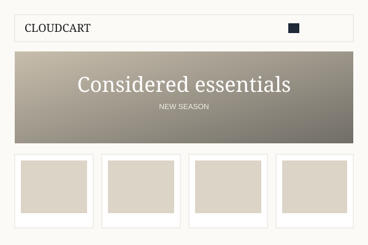
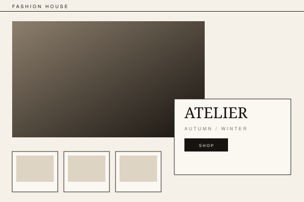
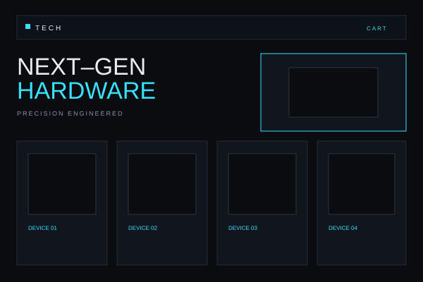
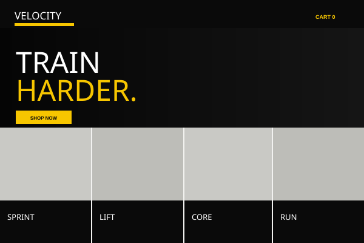

<div align="center">

# CloudCart

**A free, open-source, plugin-based ecommerce platform built natively for Cloudflare Workers.**

One Worker · One D1 database · One R2 bucket · Zero monthly hosting bill

[](https://deploy.workers.cloudflare.com/?url=https://github.com/shuo-huge/cloudcart)

[](https://workers.cloudflare.com/)
[](https://developers.cloudflare.com/d1/)
[](LICENSE)
[](docs/TEST_REPORT.md)

[English](README.md) · [简体中文](README.zh-CN.md) · [Architecture](docs/ARCHITECTURE.md) · [Deployment](docs/DEPLOYMENT.md)

</div>

---

## Why CloudCart?

Opening a small online store should not cost more than the products you sell.

CloudCart exists because most ecommerce stacks force you to choose between paying a monthly platform fee, maintaining a server, or giving up control of your data. It removes that trade-off by using Cloudflare's free tier as the entire runtime: edge compute, SQLite, object storage, and static assets.

### The problems it solves

| Pain point | How CloudCart fixes it |
|---|---|
| **Shopify-style subscriptions + paid apps** | No platform subscription. Runs inside Cloudflare Workers Free. You pay for your domain and payment-provider fees, not hosting. |
| **VPS, MySQL, Redis, SSL, backups** | No server to patch, no database to provision. D1 and R2 are managed by Cloudflare; D1 exports give you a portable SQL backup. |
| **SaaS lock-in and shared tenants** | Every store is its own Worker + D1 + R2 in **your** Cloudflare account. You own the data, the code, and the domain. |
| **Heavy SSR frameworks exceed free CPU limits** | Hono + Preact + small string-based SSR. Every public page is still server-rendered and SEO-readable. |
| **Expensive themes and closed page builders** | 8 structurally different bundled themes, a live three-column page editor, and a documented Theme SDK. MIT licensed. |
| **Payment plugins that require a paid backend** | Manual payment, Stripe Checkout, and PayPal Orders v2 are bundled. Secrets are encrypted with AES-GCM. |
| **Admin tools only in English** | The bundled Admin Language Pack adds English / 简体中文 with a runtime switcher. |
| **Fake "one-click" demos** | Every claim here is implemented. Tests run in workerd against real D1/R2 bindings. Unfinished work is listed explicitly. |

### How it compares

| | **CloudCart** | Shopify | WooCommerce |
|---|---|---|---|
| Monthly platform fee | **$0** on Cloudflare Free | Subscription + paid apps | $0 software, paid hosting |
| Hosting | Cloudflare edge | Included | VPS ($5–20+/mo) |
| Database | D1 (SQLite), included | Vendor-managed | MySQL you maintain |
| Data ownership | **Your Cloudflare account** | Vendor | Yours |
| Multiple stores | One Worker + D1 + R2 per store | Plan limits / tenants | One site per install |
| Themes | 8 bundled + SDK | Paid themes | Free/paid extensions |
| Visual page editor | Built in | Built in | Third-party |
| Open source | **MIT** | No | GPL |

---

## One-click deploy

[](https://deploy.workers.cloudflare.com/?url=https://github.com/shuo-huge/cloudcart)

Cloudflare's Deploy button clones this repository into Workers Builds on **your** account. It reads `wrangler.jsonc`, provisions the D1 database and R2 bucket, and runs the project's `build` and `deploy` scripts.

You will be asked for two secrets from `.dev.vars.example`:

| Secret | Purpose |
|---|---|
| `APP_MASTER_KEY` | Signs sessions and encrypts payment credentials. Generate a long random value. |
| `SETUP_TOKEN` | One-time token that allows the first administrator to be created. |

Generate them before deploying:

```bash
openssl rand -base64 48   # APP_MASTER_KEY
openssl rand -base64 32   # SETUP_TOKEN
```

PowerShell:

```powershell
[Convert]::ToBase64String([Security.Cryptography.RandomNumberGenerator]::GetBytes(48))
[Convert]::ToBase64String([Security.Cryptography.RandomNumberGenerator]::GetBytes(32))
```

CloudCart refuses to complete setup if the example placeholder values are still in use.

After deployment, open `https://<your-worker>.workers.dev/setup` and use the `SETUP_TOKEN` to create the store owner. **There is no default admin password.** The setup screen closes permanently after the first admin is created.

> **Deployment honesty:** Cloudflare's button can provision D1 and R2, but its behaviour depends on your account and the current Cloudflare feature set. If provisioning or secret setup fails, use the fully automated CLI below. CloudCart never upgrades your plan automatically.

---

## CLI deploy (recommended for a complete setup)

```bash
git clone https://github.com/shuo-huge/cloudcart.git
cd cloudcart
pnpm install
pnpm run deploy:cloudflare
```

The CLI checks Node, Wrangler and Cloudflare login, then:

1. finds or creates a D1 database,
2. finds or creates an R2 bucket,
3. writes the real IDs into `wrangler.jsonc`,
4. builds the storefront and admin,
5. applies remote migrations,
6. deploys the Worker,
7. creates `APP_MASTER_KEY` and `SETUP_TOKEN` if missing,
8. prints the store URL, admin URL and one-time setup link.

Re-running is safe: existing resources and secrets are reused, and no data is overwritten.

```bash
pnpm run deploy:cloudflare -- --name my-store   # named Worker / resources
pnpm run deploy:cloudflare -- --check           # non-mutating environment check
```

---

## Local development

Requirements: Node.js 20+ and pnpm 10+.

```bash
pnpm install
cp .dev.vars.example .dev.vars    # edit the two values
pnpm db:migrate:local
pnpm build
pnpm dev
```

Open <http://localhost:8787/setup> and use the `SETUP_TOKEN` from `.dev.vars`.

| URL | Purpose |
|---|---|
| `/` | Server-rendered storefront |
| `/admin` | Admin SPA |
| `/setup` | One-time installation |
| `/api/*` | Public and admin APIs |
| `/webhooks/stripe`, `/webhooks/paypal` | Payment webhooks |

---

## What you get

### Storefront
Server-rendered HTML for home, collections, search, product pages, cart, checkout and content pages. Meta tags, canonical URLs, Open Graph, Twitter cards, Product/Breadcrumb/Website JSON-LD, `sitemap.xml`, `robots.txt`, and 301 redirects are built in. Product names and descriptions are crawlable without JavaScript.

### Admin
Dashboard, products and variants, categories, images (R2), orders, customers, discounts, shipping zones and rates, themes, visual page builder, plugins, payment configuration, media library, store settings, SEO redirects, audit log, and local resource estimates.

### Commerce core
Server-side revalidation of prices, stock, coupons and shipping on every checkout. Integer minor-unit money, order snapshots, atomic stock reservation with compensation, an explicit order state machine, manual payment confirmation with an audit trail, and manual shipment tracking.

### 8 bundled themes
Default, Fashion, Beauty, Electronics, Jewelry, Home, Sports, and Single Product. Each has a different layout, typography and card structure, not just a colour swap. All support the same Theme SDK and design tokens.

| Default | Fashion | Electronics | Sports |
|---|---|---|---|
|  |  |  |  |

### Visual page editor
Three-column editor with SortableJS drag ordering, add/remove/duplicate/hide sections, per-section content and style fields, live preview at desktop/tablet/mobile widths, autosaved drafts, undo/redo, publish, and immutable version snapshots. Page JSON is schema-validated and custom HTML is sanitised.


### Payments
- **Manual**: bank transfer, cash on delivery, or custom instructions; admin confirmation with audit.
- **Stripe Checkout**: raw-body signature verification, amount/currency checks, idempotent event processing.
- **PayPal Orders v2**: server-side capture, webhook verification through PayPal's API, amount checks.

Provider credentials are AES-GCM encrypted with a key derived from `APP_MASTER_KEY` and never returned to the browser.

### Plugins
Build-time bundled, runtime enabled/disabled, with D1-backed settings. The registry rejects plugins that are not in the current build. Included: Manual, Stripe, PayPal, and the **Admin Language Pack** (English / 简体中文, default language and switcher).

### Security
PBKDF2 passwords, HMAC-bound session cookies, CSRF double-submit, login rate limiting, prepared statements everywhere, an allow-list HTML sanitiser, magic-byte image validation, open-redirect protection, verified webhooks, and audit logging.

---

## Architecture at a glance

```
Browser
  └─ Cloudflare edge
       ├─ Workers Static Assets     /static/*, /static/admin-ui/*
       └─ Worker (Hono)             /, /api/*, /admin, /media/*, /webhooks/*
            ├─ D1 (SQLite)          products, orders, pages, settings, sessions…
            └─ R2                    product images and uploads
```

```
apps/worker       Hono API, SSR, webhooks, media, admin shell
apps/admin        Preact admin SPA + page editor
apps/storefront   small client bundle (cart, newsletter)
packages/core     commerce services and business rules
packages/database D1 wrapper, row types, resource guard
packages/security Web Crypto, sessions, secret encryption, sanitising
packages/shared   money, ids, slugs, types
packages/plugin-sdk, theme-sdk, ui
plugins/          admin/i18n, payments/{manual,stripe,paypal}
themes/           8 bundled themes
migrations/       3 D1 migrations
scripts/          deploy CLI and asset preparation
tests/            workerd integration tests
docs/             architecture, plugin/theme/payment/deployment/security/testing docs
```

Read [docs/ARCHITECTURE.md](docs/ARCHITECTURE.md) for the full design, order state machine, payment event pipeline, and free-tier strategy.

---

## Project status

**v0.1.0 — functional, not yet declared 1.0.** The repository is honest about what works and what does not.

Implemented and tested: setup/login/CSRF, products/categories/media, server cart, guest checkout, stock reservation, manual payment, order fulfilment, 8 themes, page editor draft/preview/publish, Stripe signature + idempotency, PayPal order/capture/webhook verification, admin language pack, 24 workerd tests.

Not yet verified or missing:
- No live Stripe/PayPal Sandbox transaction has been run in this repository; provider APIs are mocked in tests.
- No real Cloudflare deployment was executed while building this release; the deploy CLI's environment check passes.
- PayPal uses hosted approval redirects, not embedded Smart Buttons.
- No email delivery, tax calculation, page-version restore, or image reordering yet.
- Theme previews are original SVG artwork, not screenshots of a running store.

See [docs/TEST_REPORT.md](docs/TEST_REPORT.md) for the exact verification matrix and known gaps.

---

## Documentation

- [PRD](docs/PRD.md)
- [Architecture](docs/ARCHITECTURE.md)
- [Plugin development](docs/PLUGIN_DEVELOPMENT.md)
- [Theme development](docs/THEME_DEVELOPMENT.md)
- [Payment integration](docs/PAYMENT_INTEGRATION.md)
- [Deployment](docs/DEPLOYMENT.md)
- [Security](docs/SECURITY.md)
- [Free-tier budget](docs/FREE_TIER_BUDGET.md)
- [Test report](docs/TEST_REPORT.md)

---

## Contributing

CloudCart is MIT licensed. Themes, plugins, translations, bug reports and performance improvements are welcome.

- Add a theme: [docs/THEME_DEVELOPMENT.md](docs/THEME_DEVELOPMENT.md)
- Add a plugin: [docs/PLUGIN_DEVELOPMENT.md](docs/PLUGIN_DEVELOPMENT.md)
- Report a security issue privately rather than opening a public issue.
- If this project saves you a monthly bill, a star helps others find it.

## License

MIT. See [LICENSE](LICENSE). Third-party dependencies keep their own licenses.
