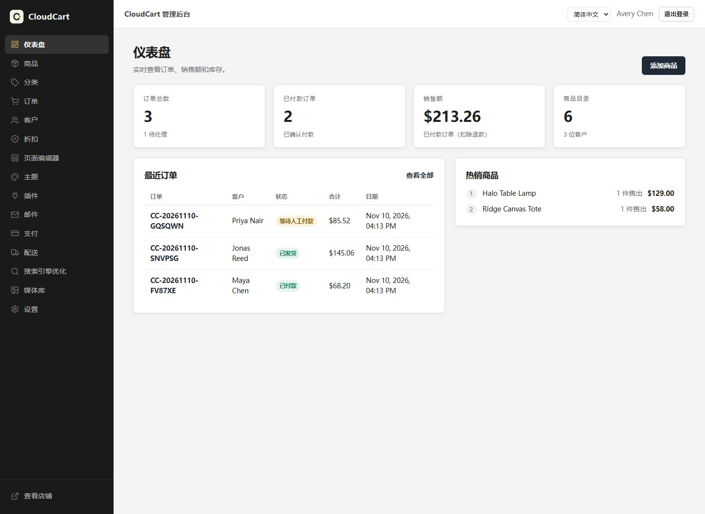
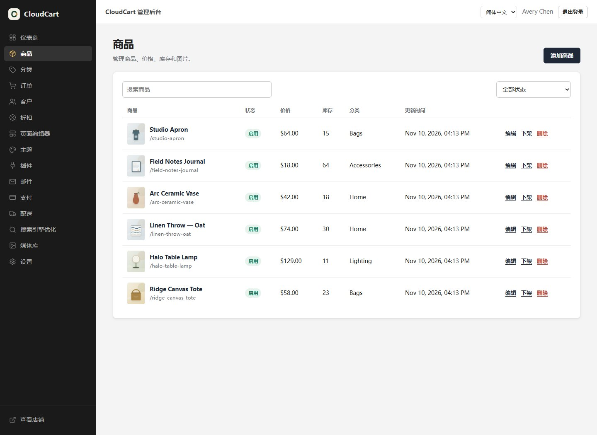
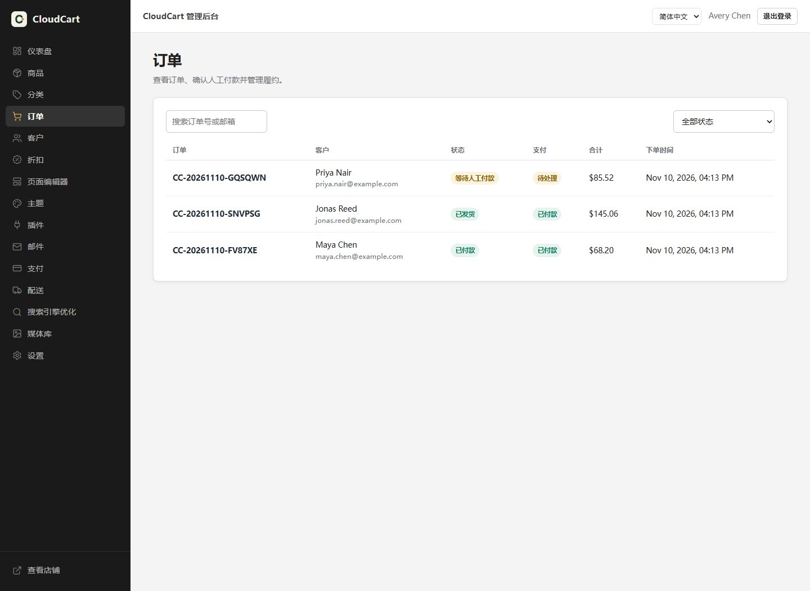
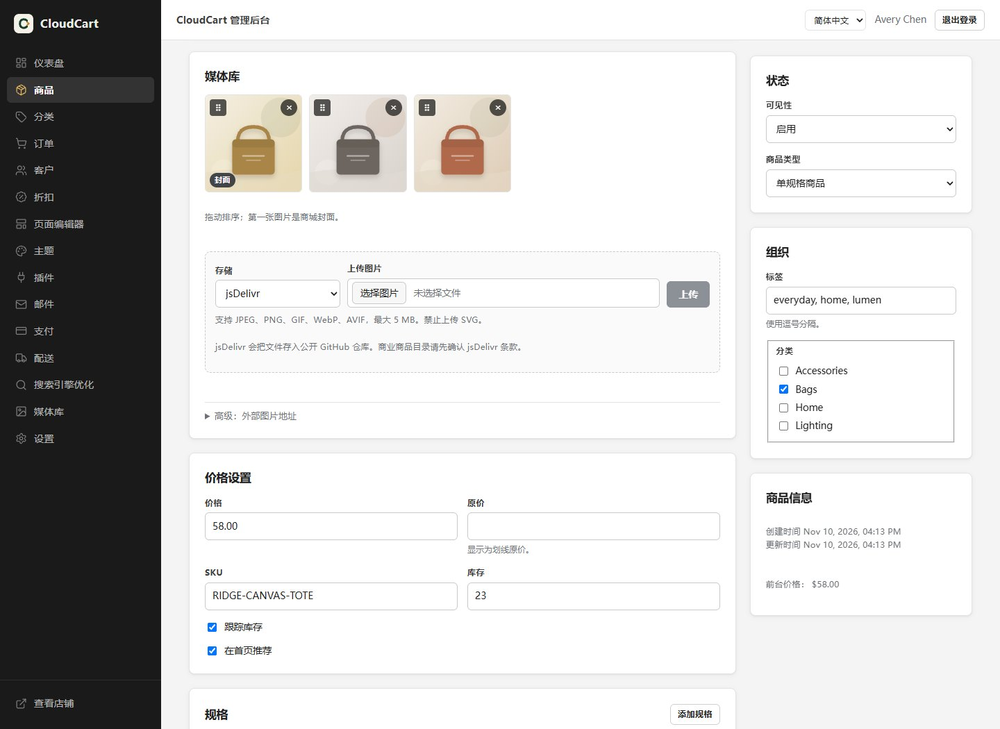
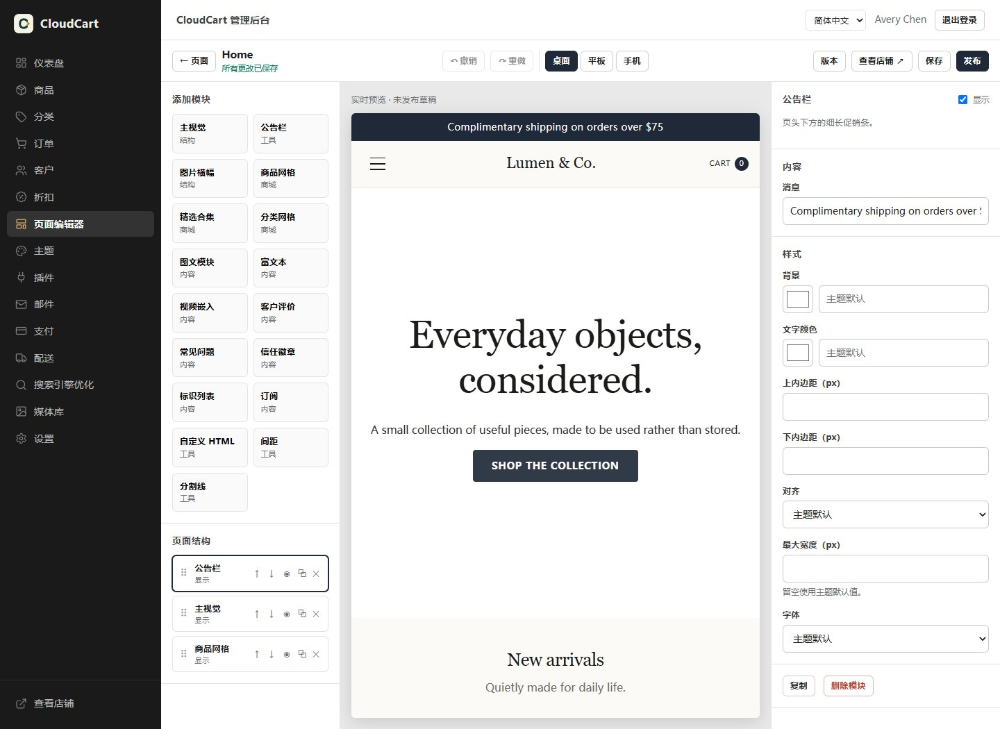
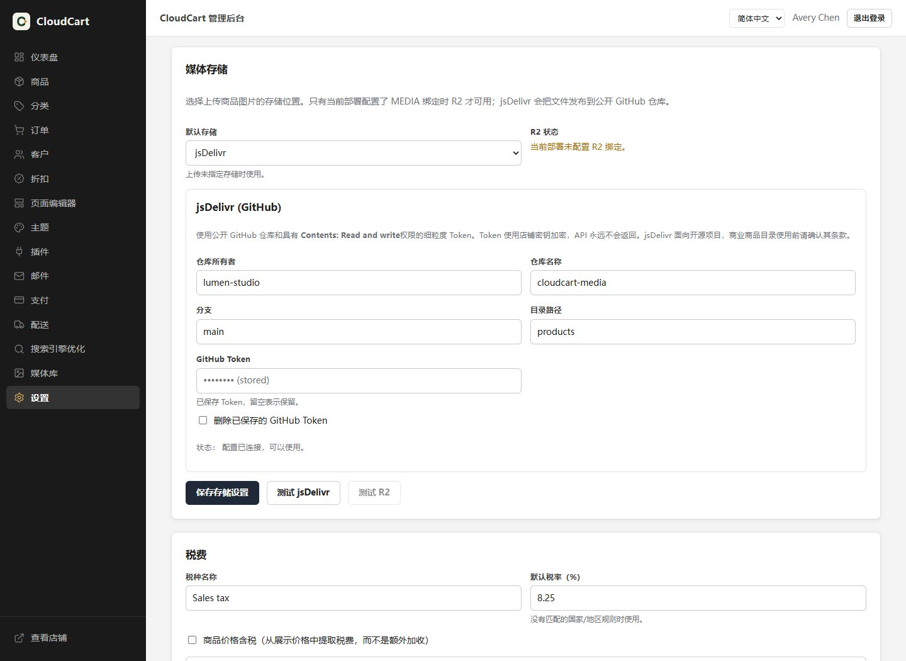
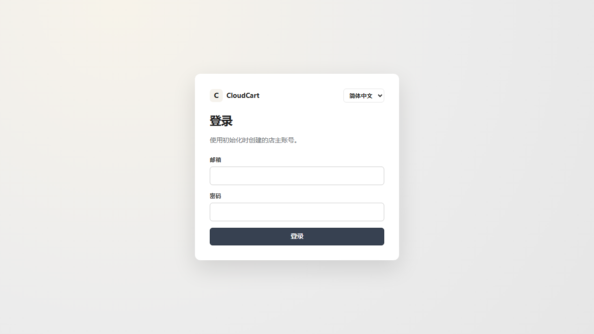

<div align="center">

# CloudCart

**免费、开源、插件化的电商系统，原生运行在 Cloudflare Workers 上。**

一个 Worker · 一个 D1 数据库 · 图片本地上传（R2/jsDelivr）· 外链可选

[](https://deploy.workers.cloudflare.com/?url=https://github.com/shuo-huge/cloudcart)

[](https://workers.cloudflare.com/)
[](https://developers.cloudflare.com/d1/)
[](LICENSE)

[English](README.md) · [简体中文](README.zh-CN.md) · [架构文档](docs/ARCHITECTURE.md) · [部署文档](docs/DEPLOYMENT.md)

</div>

---

## 为什么做 CloudCart？

开一个小网店，不应该在产品还没卖出去之前先交一堆月费。

大多数电商方案都会逼你三选一：交平台月费、自己维护服务器、或者放弃数据控制权。CloudCart 用 Cloudflare 免费额度作为整套运行时——边缘计算、SQLite、对象存储、静态资源——把这道选择题直接去掉。

### 它解决的痛点

| 痛点 | CloudCart 的做法 |
|---|---|
| **Shopify 式月费 + 付费插件** | 没有平台订阅费。运行在 Cloudflare Workers Free 上，你只需要付域名和支付渠道手续费。 |
| **VPS、MySQL、Redis、SSL、备份** | 没有服务器要维护。D1 由 Cloudflare 托管，图片可上传到 R2 或通过 jsDelivr 发布；外链仍可选。 |
| **SaaS 锁定、多租户共享数据** | 每个商城都是你自己 Cloudflare 账户里的独立 Worker + D1；R2 可按需接入。数据、代码、域名都归你。 |
| **重型 SSR 框架超出免费 CPU 限制** | Hono + Preact + 轻量字符串渲染，页面依然服务端渲染、SEO 可读。 |
| **主题和页面编辑器贵且封闭** | 8 套结构不同的内置主题、三栏可视化编辑器、完整 Theme SDK，MIT 开源。 |
| **支付插件依赖付费后端** | 内置人工支付、Stripe Checkout、PayPal Orders v2，密钥使用 AES-GCM 加密。 |
| **后台只有英文** | 内置 Admin Language Pack，支持 English / 简体中文，可运行时切换。 |
| **假“一键部署”** | 这里列出的功能都真实实现。测试在 workerd 中连接 D1 运行；R2 文件上传为可选能力，未完成项明确列出。 |

### 和常见方案对比

| | **CloudCart** | Shopify | WooCommerce |
|---|---|---|---|
| 平台月费 | **0 元**（Cloudflare 免费额度） | 订阅费 + 付费 App | 软件免费，托管付费 |
| 托管 | Cloudflare 边缘网络 | 包含 | VPS（$5–20+/月） |
| 数据库 | D1（SQLite），包含 | 平台托管 | 自己维护 MySQL |
| 数据归属 | **你的 Cloudflare 账户** | 平台 | 自己 |
| 多商城 | 每店独立 Worker + D1，R2 可选 | 套餐/租户限制 | 每站点独立安装 |
| 主题 | 8 套内置 + SDK | 多为付费 | 免费/付费扩展 |
| 可视化编辑器 | 内置 | 内置 | 第三方 |
| 开源 | **MIT** | 否 | GPL |

---

## 后台截图

以下截图来自运行中的 CloudCart 后台，使用演示商品数据和简体中文语言包。英文 README 展示相同页面的英文界面。

| 仪表盘 | 商品目录 |
| :---: | :---: |
|  |  |
| **订单与履约** | **商品编辑与本地图片上传** |
|  |  |
| **可视化页面编辑器** | **媒体存储：R2 或 jsDelivr** |
|  |  |

---

## 一键部署到 Cloudflare

[](https://deploy.workers.cloudflare.com/?url=https://github.com/shuo-huge/cloudcart)

Cloudflare 会把 CloudCart 部署到**你的账户**并创建 D1。R2 是可选的。按钮会使用仓库根目录的 `build` 和 `deploy` 脚本：先构建前台和后台，再执行 `scripts/deploy.mjs`。**不需要手动生成、复制或填写任何密钥。** 部署脚本会自动生成 `APP_MASTER_KEY` 和 `SETUP_TOKEN`，将它们保存为 Worker Secret，并在部署日志中输出一个私密的一次性安装链接。

打开最近一次成功部署日志中的 **Setup link**。安装页面只需要填写管理员姓名、邮箱和密码。商店名称和货币使用默认值，安装后可以在后台「设置」中修改。初始化令牌已经包含在私密链接中，不会作为表单字段显示。

创建第一个管理员后，一次性链接立即失效。如果在初始化前再次部署，请使用最新一次成功部署日志中的新链接。系统没有默认管理员密码。

### 部署成功后，我的网站链接在哪里？

一键部署按钮在 Cloudflare 云端运行，无法在你的电脑上自动打开浏览器。可以从这两个地方找到网址：

1. **构建日志**：**Workers & Pages → 你的项目 → Deployments / 部署 → 最新一次 → Build logs / 构建日志**。日志最后会显示 `Website / 网站: https://…` 和一次性安装链接。
2. **Dashboard**：**Workers & Pages → 你的项目 → Visit**。`https://<worker>.<子域>.workers.dev` 也可以在该项目的 **Settings → Domains & Routes** 中看到。

如果还没创建管理员就丢失了安装链接，重新执行一次部署即可；脚本会生成并打印新的一次性链接。如果商城已经安装完成，直接打开 `/admin` 登录。

## CLI 部署（推荐，最完整）

```bash
git clone https://github.com/shuo-huge/cloudcart.git
cd cloudcart
pnpm install
pnpm run deploy:cloudflare
```

脚本会依次检查 Node、Wrangler 和 Cloudflare 登录状态，然后：

1. 查找或创建 D1 数据库（优先复用一键部署按钮已创建的数据库）；
2. 把真实 ID 写入 `wrangler.jsonc`；
3. 构建前台和后台；
4. 通过 `DB` 绑定执行远程数据库迁移；
5. 部署 Worker；
6. 保留现有 `APP_MASTER_KEY`，并在商城尚未初始化时生成或刷新一次性安装令牌；
7. 输出商城地址、后台地址和一次性初始化链接。

可重复执行：已有资源和密钥会复用，不会覆盖业务数据。在本地交互式终端运行时，脚本部署完成后会自动打开商城/安装页面；使用 `--no-open`（或 `CLOUDCART_NO_OPEN=1`）可以关闭自动打开。

```bash
pnpm run deploy:cloudflare -- --name my-store   # 指定 Worker/资源名称
pnpm run deploy:cloudflare -- --check           # 只检查环境，不修改资源
pnpm run deploy:cloudflare -- --no-open         # 不自动打开浏览器
```

---

## 本地开发

要求：商城使用 Node.js 20+（CI 使用 24，`.nvmrc` 固定 22）、pnpm 10+（`packageManager` 固定 12.16.1）。文档站使用 Astro 6，需要 Node.js 22.12+。

```bash
pnpm install
pnpm db:migrate:local
pnpm dev
```

`pnpm dev` 会自动在本地生成 `.dev.vars` 随机密钥，并输出一次性安装链接。已有本地密钥会被保留，不会每次启动都更换。

浏览器端到端测试使用 Playwright，并连接隔离的本地 D1 数据库：

```bash
pnpm exec playwright install chromium
pnpm test:e2e
```

| 地址 | 用途 |
|---|---|
| `/` | 服务端渲染商城 |
| `/admin` | 后台管理 SPA |
| `/setup` | 一次性初始化 |
| `/api/*` | 公开与后台 API |
| `/webhooks/stripe`, `/webhooks/paypal` | 支付回调 |

---

## 文档站

公开使用文档已部署在 **https://cloudcart-docs.cloudcart-shuo-preview.workers.dev**，支持简体中文 / English 语言切换。文档源码在 `apps/docs`，使用 Astro Starlight 构建，和商城 Worker 分开部署。

```bash
pnpm docs:dev       # 本地预览 http://localhost:4321
pnpm docs:build     # 静态产物在 apps/docs/dist
pnpm docs:deploy    # 构建并部署 cloudcart-docs Worker
```

`docs:deploy` 使用 `wrangler.docs.jsonc`，部署一个独立的静态资源 Worker：`cloudcart-docs`。也可以把 `apps/docs/dist` 通过 Cloudflare Pages 部署。

部署到正式域名前设置 `DOCS_SITE_URL`（例如 `DOCS_SITE_URL=https://docs.example.com`），这样 canonical 和 sitemap 会使用正式域名。

中文页面在 `apps/docs/src/content/docs/**/*.md`（`/`），英文页面在 `apps/docs/src/content/docs/en/**/*.md`（`/en/`）。左侧目录及英文标签在 `apps/docs/astro.config.mjs`。

品牌图标在 `brand/`。提交到仓库的 favicon / App icon 由其中的 SVG 母版生成；修改图标后运行 `pnpm icons` 重新生成。

---

## 管理 CLI（面向智能体）

`apps/cli` 把后台 API 封装成零依赖的 Node CLI，Claude Code、Cursor、Codex、Gemini CLI 和脚本都可以不打开浏览器就完成商品上架、页面/博客发布、订单处理和营销配置。

```bash
# 首次登录：自动创建 API Key 并保存到用户目录
pnpm cloudcart auth login --url https://your-store.example.com --email owner@example.com

# 内容运营
pnpm cloudcart products list --json
pnpm cloudcart products create --name "帆布托特包" --price 25.00 --status active --image https://example.com/tote.jpg --json
pnpm cloudcart blog create --title "上新说明" --slug launch-notes --text-file post.html --publish --json

# 订单与营销
pnpm cloudcart orders list --json
pnpm cloudcart coupons create --code SAVE10 --type percent --value 10 --json

# 智能体发现命令
pnpm cloudcart capabilities --json
pnpm cloudcart schema product
```

非交互智能体可以直接设置 `CLOUDCART_URL` 和 `CLOUDCART_API_KEY`。写操作加 `--json` 获得稳定输出，先跑 `--dry-run`，删除类操作显式加 `--yes`。API Key 按资源限权、在 D1 中只存哈希、可通过 `cloudcart auth logout` 撤销。

商品图片可以在后台或 CLI 直接上传。在 **Settings → Media storage** 配置默认存储：

- **R2**：部署存在 `MEDIA` binding 时可用
- **jsDelivr**：使用 fine-grained PAT（Contents: Read and write）发布到公开 GitHub 仓库，Token 加密保存

```bash
pnpm cloudcart media upload ./photo.jpg --storage jsdelivr --json
pnpm cloudcart products images attach PRODUCT_ID --image-url https://example.com/photo.jpg --storage jsdelivr --json
```

外部 HTTPS 图片仍可通过后台高级面板或 CLI 的 `--external` 使用。`publish:jsdelivr` 手动发布脚本保留。jsDelivr 定位是开源项目 CDN，商业商品目录请先确认其条款；生产环境更建议 R2。

博客复用内容页：每篇文章发布到 `/pages/<slug>`，正文是一个 rich-text section。CloudCart 没有独立的 posts 表、`/blog` 列表或 RSS。完整命令见 [`docs/CLI.md`](docs/CLI.md)。

## 功能

### 商城前台
首页、分类、搜索、商品详情、购物车、结账、订单确认、内容页全部服务端渲染。内置 Meta 标签、Canonical、Open Graph、Twitter Card、商品/面包屑/网站 JSON-LD、`sitemap.xml`、`robots.txt`、301 重定向。不依赖 JavaScript 也能被抓取商品名称和描述。

### 后台
Dashboard、商品与规格、分类、本地上传到 R2 或 jsDelivr（外链为高级选项）、可拖拽排序的商品图片、订单、按商品登记退货并可选回补库存、未付款订单自动关闭、客户、优惠券、配送区域与运费、税率、主题、支持版本回滚的可视化页面编辑器、插件、邮件通知与定时重试发件箱、支付配置、媒体库、店铺设置、SEO 重定向、审计日志、资源用量估算。

### 交易核心
每次结账都在服务端重新校验价格、库存、优惠、运费和税费。金额使用整数最小货币单位，保存订单快照，库存使用条件更新与补偿机制，订单状态机显式约束，人工确认收款记录管理员和时间，支持手动填写物流单号。税费支持国家/地区税率规则、默认税率，以及含税价/不含税价；税费计入订单总额并自动同步到支付金额。

### 8 套内置主题
Default、Fashion、Beauty、Electronics、Jewelry、Home、Sports、Single Product。每套主题的布局、字体、商品卡片结构都不同，而不是只换颜色；全部接入同一套 Theme SDK 和设计变量。

主题库预览来自一张 4×2 的 WebP 图集（`apps/storefront/public/themes/theme-previews-atlas.webp`），通过 CSS 裁切显示，并支持后台全屏预览弹窗。预览图是示意素材，不是运行中店铺的截图。

### 可视化页面编辑器
三栏布局，SortableJS 拖拽排序，新增/删除/复制/隐藏模块，模块内容与样式配置，桌面/平板/手机实时预览，自动保存草稿，撤销/重做，发布并生成不可变版本快照，可把任意已发布版本恢复为草稿。页面 JSON 服务端校验，自定义 HTML 严格消毒。



### 支付
- **人工支付**：银行转账、货到付款、自定义说明，管理员确认收款并写入审计。
- **Stripe Checkout**：原始请求体验签、金额/币种核对、事件幂等。
- **PayPal Orders v2**：服务端 Capture、PayPal 验签 API、金额核对。

支付密钥使用由 `APP_MASTER_KEY` 派生的 AES-GCM 密钥加密，永远不会返回浏览器。

### 插件
内置插件构建时打包、运行时启停，设置保存在 D1；未打包进当前 Worker 的内置插件无法启用。内置：Manual、Stripe、PayPal、**Admin Language Pack**（English / 简体中文），以及 **Email Notifications**（Resend 或 Cloudflare Email Workers，D1 发件箱、定时失败重试和后台日志；默认关闭）。

**远程插件**通过 Manifest URL 安装，无需重新构建 Worker。插件代码和后台页面运行在插件作者自己的 HTTPS 服务上；CloudCart 只保存 Manifest 并调用签名 API。启用的远程插件会自动在后台左侧添加菜单，并通过 iframe 打开。iframe 通过 `postMessage` 获得 5 分钟、按插件限权的 JWT，可调用 `/api/plugin/v1/*` 受限 API；禁用后下一次请求立即失效。完整示例见 [`examples/remote-plugin`](examples/remote-plugin)。

### 安全
PBKDF2 密码、HMAC Session、CSRF 双提交、登录限流、全部预编译 SQL、HTML 白名单消毒、图片魔数校验、开放重定向防护、Webhook 验签、审计日志。

---

## 架构概览

```
浏览器
  └─ Cloudflare 边缘
       ├─ Workers Static Assets     /static/*, /static/admin-ui/*
       └─ Worker (Hono)             /, /api/*, /api/plugin/v1/*, /admin, /media/*, /webhooks/*
            ├─ D1 (SQLite)          商品、订单、页面、设置、会话…
            ├─ 可选 R2               直接上传图片（也可用 jsDelivr 或 HTTPS 外链）
            └─ 远程插件              插件作者服务器上的签名 HTTPS API + iframe 后台
```

```
apps/worker       Hono API、SSR、Webhook、媒体、后台壳
apps/admin        Preact 后台 SPA 与页面编辑器
apps/storefront   小型前台脚本（购物车、订阅）
apps/docs         Astro Starlight 公开文档站
apps/cli          面向智能体的管理 CLI（零依赖）
packages/core     商品、订单、支付、页面、主题、SEO 等业务逻辑
packages/database D1 封装、行类型、资源保护
packages/security Web Crypto、会话、密钥加密、消毒
packages/shared   金额、ID、Slug、类型
packages/plugin-sdk, theme-sdk, ui
plugins/          admin/i18n、payments/{manual,stripe,paypal}、notifications/email
examples/         remote-plugin 远程插件示例
themes/           8 套内置主题
brand/            CloudCart 图标母版与生成后的 favicon/App icon
migrations/       11 个 D1 迁移
scripts/          部署 CLI、图标生成、jsDelivr 图片发布
tests/            workerd 集成测试
docs/             架构、插件、主题、支付、部署、安全、测试文档
```

完整设计、订单状态机、支付事件流水线和免费额度策略见 [docs/ARCHITECTURE.md](docs/ARCHITECTURE.md)。

---

## 项目状态

**v0.5.0 — 功能可用，但尚未宣称 1.0。** 已实现和未实现的事项都明确列出。

已实现并通过测试：初始化/登录/CSRF、商品/分类/图片、可拖拽排序的商品图片、服务端购物车、访客结账、库存预占、税费计算（含税/不含税、国家/地区规则）、人工支付、订单履约、8 套主题、页面编辑器草稿/预览/发布与版本回滚、Stripe 验签与幂等、PayPal 下单/Capture/Webhook 验签、后台语言包、带 D1 发件箱和重试的邮件通知、内置/远程混合插件与 iframe 后台、短期插件 JWT、HMAC 服务调用、远程支付适配器、R2/jsDelivr 本地上传与加密凭据、面向智能体的 API Key 管理 CLI、127 个 workerd 测试、21 个 CLI Node 测试、12 个 Playwright 浏览器测试（含 setup 共 13 个）。

未验证或尚未完成：
- 已于 2026-11-11 使用测试卡 `4242 4242 4242 4242` 完成真实 Stripe Sandbox 支付验证（订单 `CC-20261111-SDFVBC`）；PayPal Sandbox 账号仍待补充。自动化测试中的支付接口仍使用 mock。
- 维护者账户中的 Cloudflare 部署已验证（Workers Builds 与 `wrangler deploy` 均成功）。
- PayPal 使用托管审批跳转，不是嵌入式 Smart Buttons。
- 尚未接入真实邮件服务商发送；Resend 与 Cloudflare 通道使用 mock 或单元测试验证。
- 暂无公共插件市场、发布者签名、评分、付费或自动更新。
- 不支持远程主题、远程店铺前端、远程运费/商品核心逻辑。
- 暂无免税客户证明、按商品配置税类。
- 主题预览是 WebP 图集中的示意素材，不是真实店铺截图。

精确验证矩阵和已知缺口见 [docs/TEST_REPORT.md](docs/TEST_REPORT.md)。

---

## 文档

- [产品需求 PRD](docs/PRD.md)
- [CLI 与智能体](docs/CLI.md)
- [架构](docs/ARCHITECTURE.md)
- [插件开发](docs/PLUGIN_DEVELOPMENT.md)
- [主题开发](docs/THEME_DEVELOPMENT.md)
- [支付接入](docs/PAYMENT_INTEGRATION.md)
- [部署](docs/DEPLOYMENT.md)
- [安全](docs/SECURITY.md)
- [免费额度预算](docs/FREE_TIER_BUDGET.md)
- [测试报告](docs/TEST_REPORT.md)

---

## 参与贡献

项目使用 MIT 协议。欢迎提交主题、插件、翻译、Bug 报告和性能改进。

- 新增主题：[docs/THEME_DEVELOPMENT.md](docs/THEME_DEVELOPMENT.md)
- 新增插件：[docs/PLUGIN_DEVELOPMENT.md](docs/PLUGIN_DEVELOPMENT.md)
- 安全问题请私下报告，不要直接开公开 Issue。
- 如果这个项目帮你省下了每月账单，点一个 Star 能让更多人看到它。

## License

MIT，详见 [LICENSE](LICENSE)。第三方依赖遵循各自许可证。
